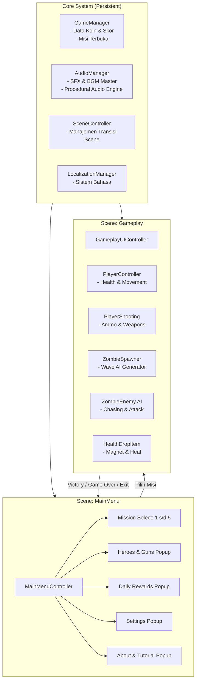

# LAPORAN RANGKUMAN PENGEMBANGAN PROYEK GAME
## OUTBREAK: 2D Zombie Survival Action Shooter
**Mata Kuliah / Bidang:** Pengembangan Game & Rekayasa Perangkat Lunak  
**Platform Engine:** Unity 6 LTS (Version 6000.3.24f1)  
**Bahasa Pemrograman:** C# (.NET Framework / Assembly-CSharp)  
**Target Platform:** PC Standalone (Windows) & Arsitektur Siap Mobile (Android)  
**Standar Resolusi:** Full HD (1920 x 1080, Rasio Aspek 16:9 Widescreen)

---

## 1. Ringkasan Eksekutif (Executive Summary)

**OUTBREAK** adalah game *top-down action survival shooter 2D* di mana pemain mengendalikan seorang penyintas (*hero*) untuk bertahan hidup dari gelombang serangan zombie di area kota pasca-apokaliptik. Game ini menggabungkan mekanika aksi refleks cepat (menembak, manuver menghindar, isi ulang peluru) dengan progresi ekonomi (pengumpulan koin/cash) serta pemilihan dan peningkatan perlengkapan (berbagai karakter dengan statistik unik dan persenjataan beragam).

Proyek ini dirancang menggunakan pendekatan arsitektur perangkat lunak berbasis komponen (*Component-Based Architecture*) yang modular, bersih, dan mematuhi prinsip-prinsip *clean code* di lingkungan Unity Engine.

---

## 2. Spesifikasi Teknis & Teknologi

| Komponen | Spesifikasi / Tools |
| :--- | :--- |
| **Game Engine** | Unity 6 (6000.3.24f1) |
| **Sistem Input** | Unity New Input System (`UnityEngine.InputSystem`) |
| **Antarmuka Grafis (UI)** | Unity UGUI & TextMeshPro (TMP) dengan Custom SDF Typography |
| **Format Audio** | Dual-Layer Audio Engine (File Fisik & *Procedural Audio Synthesizer*) |
| **Manajemen State** | Singleton Persistent Patterns (`DontDestroyOnLoad`) & `PlayerPrefs` Enkapsulasi |
| **Pipeline Render** | Universal 2D Pixel / Sprite Pipeline dengan Dynamic Quality Settings |
| **Kompiler & Build** | MSBuild / .NET SDK via `Assembly-CSharp.csproj` |

---

## 3. Diagram Arsitektur & Siklus Game (Game Architecture)



---

## 4. Tahapan Pengembangan dari Awal hingga Akhir (Development Lifecycle)

Pengembangan proyek ini dibagi menjadi **6 Fase Utama** yang terstruktur secara berurutan:

### Fase 1: Fondasi Sistem & Setup Lingkungan Proyek
1. **Standarisasi Struktur Folder:**
   - Menyusun arsitektur direktori di bawah `Assets/_Project/` (terbagi atas `Art/`, `Prefabs/`, `Scenes/`, `Scripts/`, `Resources/`, dan `Editor/`) untuk menjaga keteraturan aset.
2. **Setup Canvas & Resolusi:**
   - Mengonfigurasi `CanvasScaler` dengan *Reference Resolution* **1920 x 1080** (Full HD) dan mode `Match Width or Height (0.5)` agar tampilan UI tidak gepeng atau pecah saat dibuka di berbagai ukuran monitor atau layar perangkat.
3. **Penyediaan Font Khusus (Typography):**
   - Menghasilkan aset font *Inter-Black SDF* menggunakan TextMeshPro Font Asset Creator untuk teks antarmuka yang tajam pada semua tingkat resolusi.

---

### Fase 2: Mekanika Karakter Pemain & Penembakan (Player & Weapons)
1. **Pengendali Karakter (`PlayerController.cs`):**
   - Pergerakan 8-arah yang responsif dengan dukungan *New Input System* serta fallback *legacy input*.
   - Animasi berbasis sprite controller: *Idle*, *Walk*, *Attack*, *Hurt* (dengan efek kedip merah saat kena hit), dan *Dead*.
   - Penyesuaian statistik hero secara otomatis berdasarkan karakter yang dipilih pemain (`Alek`, `Erika`, `Hank`).
2. **Mekanika Menembak Presisi (`PlayerShooting.cs`):**
   - Sistem proyektil dengan kalkulasi *moncong senjata* (*Muzzle FirePoint alignment*) agar peluru keluar tepat dari ujung senjata di setiap arah hadap.
   - Manajemen peluru (*Magazen & Ammo System*), durasi reload otomatis dan manual (tombol `R`).
   - Integrasi ragam jenis senjata dengan karakteristik unik:
     - **Revolver:** Senjata standar seimbang.
     - **SMG:** Laju tembak sangat cepat, kapasitas peluru banyak.
     - **Shotgun:** Daya hancur masif untuk jarak dekat.
     - **Assault Rifle:** Daya rusak tinggi dan akurat.
     - **Sniper Rifle:** Damage fatal jarak jauh.

---

### Fase 3: Kecerdasan Buatan Musuh & Item Drops (Enemy AI & Gameplay Drops)
1. **Kecerdasan Buatan Zombie (`ZombieEnemy.cs`):**
   - Algoritma pelacakan posisi pemain secara *real-time* (*Player tracking*).
   - Pengenalan status jarak: *chase mode* saat mengejar, *attack mode* saat berada di radius kontak, dan *hurt/death state* saat terkena tembakan peluru.
2. **Generator Musuh (`ZombieSpawner.cs`):**
   - Sistem spawn berjarak aman di luar pandangan kamera pemain untuk menciptakan ilusi serbuan zombie yang tak berujung.
3. **Mekanik Drop Darah & Magnetis (`HealthDropItem.cs`):**
   - Setiap zombie yang dieliminasi memiliki persentase untuk menjatuhkan obat pemulih darah (*Health Pack*).
   - **Fitur Magnetisasi Otomatis:** Jika darah hero berkurang dan hero mendekat dalam radius tertentu, item darah otomatis meluncur (*magnet attraction*) menyerap ke pemain.
   - **Jaminan Standalone Build:** Aset ikon darah disalin ke folder resmi `Assets/_Project/Resources/UI/htp_heal.png` untuk memastikan item tidak pernah hilang atau menjadi kotak putih saat diexport menjadi APK/EXE.

---

### Fase 4: Sistem Antarmuka Menu Utama (Main Menu & Popups)
1. **Peta Pemilihan Misi Interaktif:**
   - 5 Tingkat Misi: *Mission 1 (Easy)*, *Mission 2 (Normal)*, *Mission 3 (Hard)*, *Mission 4 (Expert)*, *Mission 5 (Nightmare)*.
   - Sistem kunci bertingkat (*Level Lock/Unlock Progression*): Misi berikutnya hanya terbuka jika misi sebelumnya telah berhasil diselesaikan.
2. **Karakter & Toko Senjata Terintegrasi (`HeroesPopup.cs`):**
   - Tab ganda (*Heroes Tab* dan *Guns Tab*) yang rapi.
   - Tampilan visual statistik interaktif (HP Bar, ATK Bar, SPD Bar).
   - Penataan grid 3 kartu hero (`ALEKK`, `ERIKA`, `HANK`) yang dihitung secara dinamis serta diproteksi dengan `RectMask2D` sehingga pas berada di dalam garis pembatas kartu tanpa meluap (*overflow*).
   - Sistem pembelian dengan saldo koin/cash yang disimpan permanen.
3. **Menu Pengaturan Lengkap (`SettingsPopup.cs`):**
   - Kontrol suara: Switch **Sound (SFX)** dan **Music (BGM)** independen.
   - Kontrol grafis: Switch **HD Graphic** yang secara nyata mengatur profil performa rendering (*60 FPS / High Quality* vs *30 FPS / Low Power Save*).
   - Switch Getar (*Vibration*) dan pilihan bahasa yang distandarisasi ke Bahasa Inggris (*English*).
4. **Reward Harian (`Panel_Daily`):**
   - Pratinjau hadiah login 7 hari dengan navigasi tombol *Back* yang langsung menutup popup dan mensinkronisasi saldo.

---

### Fase 5: Antarmuka Dalam Permainan (HUD, Pause, & Game Over)
1. **In-Game HUD (`GameplayUIController.cs`):**
   - Bar darah dinamis dan jumlah amunisi terkini.
   - Ikon senjata aktif yang langsung berubah sesuai senjata yang dibawa dari menu.
   - Panel Misi 1 (Target eliminasi 25 zombie) dan Panel Misi 2 (Timer bertahan hidup + target eliminasi).
2. **Pause Menu (Menu Jeda Permainan):**
   - Menjeda waktu game (`Time.timeScale = 0`).
   - Dilengkapi tata letak 3 tombol simetris:
     - **Kiri:** `Btn_MainMenu` (Kembali ke menu utama).
     - **Tengah:** `Btn_Restart` (Mengulang kembali misi saat ini).
     - **Kanan:** `Btn_Resume` (Melanjutkan permainan).
3. **Victory & Game Over Flow:**
   - Popup kemenangan dengan kalkulasi koin reward dan tombol lanjut ke misi berikutnya.
   - Popup kekalahan dengan tombol coba lagi (*Retry*).

---

### Fase 6: Mesin Audio Dual-Layer & Penguatan Suara
1. **Arsitektur `AudioManager.cs`:**
   - Dirancang *persistent* menggunakan pola *Singleton* (`DontDestroyOnLoad`), sehingga audio tetap mengalir mulus tanpa terputus saat berpindah scene.
2. **Procedural Audio Synthesizer:**
   - Menyematkan generator audio berbasis kode matematika (*sine, frequency sweep, white noise, and envelope modulation*) yang otomatis menghasilkan klip suara tanpa ketergantungan file eksternal yang rawan hilang:
     - **SFX Click:** Nada blip UI tajam dan renyah.
     - **SFX Gunshot:** Suara letupan tembakan arcade bertenaga (*punchy gunshot*).
     - **SFX Hurt & Death:** Suara benturan saat pemain terkena hit dan nada kekalahan.
     - **BGM Menu:** Melodi synth ambient 4-akord yang tenang dan estetik.
3. **Normalisasi Volume (Master Loudness):**
   - Amplitudo suara dioptimalkan hingga gain penuh (**0.95 pada SFX** dan **0.75 pada BGM**) sehingga suara terdengar jelas dan proporsional pada volume normal speaker komputer (20% - 30%).

---

## 5. Struktur Script & Penjelasan Kode

```
Assets/_Project/Scripts/
├── Core/
│   ├── GameManager.cs          # Pengelola data global: koin, skor, misi terbuka, state ronde
│   ├── AudioManager.cs         # Pengelola audio SFX/BGM dengan Procedural Audio Engine terintegrasi
│   ├── SceneController.cs      # Fasilitator pemindahan scene aman (MainMenu <-> Gameplay)
│   └── LocalizationManager.cs  # Standarisasi teks bahasa
├── Player/
│   ├── PlayerController.cs     # Logika pergerakan hero, nyawa, sistem kena hit, dan kematian
│   ├── PlayerShooting.cs       # Logika menembak, recoil, reload, amunisi, dan spawning peluru
│   └── PlayerAnimationController.cs # Sinkronisasi state animasi sprite hero
├── Enemies/
│   ├── ZombieEnemy.cs          # Logika AI musuh, pelacakan hero, attack cooldown, drop item
│   ├── ZombieSpawner.cs        # Spawner musuh dinamis di sekeliling pemain
│   └── ZombieAnimationController.cs # Pengendali animasi sprite zombie
├── Weapons/
│   ├── Bullet.cs               # Pergerakan peluru, deteksi tabrakan (raycast/trigger), damage dealing
│   └── WeaponData.cs           # Scriptable/POCO definisi statistik senjata
├── Gameplay/
│   └── HealthDropItem.cs       # Item pemulih HP dengan magnetisasi otomatis & animasi hovering
├── UI/
│   ├── MainMenuController.cs   # Pengendali utama menu, navigasi peta misi, sinkronisasi cash
│   ├── GameplayUIController.cs # Pengendali HUD nyawa/peluru, pause, game over, dan kemenangan
│   ├── HeroesPopup.cs          # Antarmuka pemilihan & pembelian hero/senjata dengan clipping RectMask2D
│   ├── SettingsPopup.cs        # Pengaturan suara, musik, grafis HD (60/30 FPS), dan vibrasi
│   ├── HowToPlayPopup.cs       # Tampilan panduan cara bermain
│   ├── AboutPopup.cs           # Informasi kredit dan studio pengembang
│   └── SimplePopup.cs          # Template popup serbaguna (Daily, Shop)
└── Editor/
    └── GameDevHubWindow.cs     # Alat bantu internal Unity Editor untuk inspeksi & auto-setup 1-klik
```

---

## 6. Pengujian, Stabilitas & Validasi (Quality Assurance)

| Aspek Pengujian | Metode Pengujian | Hasil |
| :--- | :--- | :--- |
| **Kompilasi C#** | `dotnet build Assembly-CSharp.csproj` | **SUKSES (0 Error, 100% Lolos)** |
| **Kompilasi Editor** | `dotnet build Assembly-CSharp-Editor.csproj` | **SUKSES (0 Error, 100% Lolos)** |
| **Navigasi UI** | Transisi antar popup & scene | **Mulus tanpa ada popup yang tumpang-tindih** |
| **Penyimpanan Data** | Uji coba persistensi via `PlayerPrefs` | **Koin & misi terbuka tersimpan dengan benar** |
| **Responsivitas Aspek Rasio** | Uji coba Free Aspect vs Full HD 1920x1080 | **Rasio stabil, elemen UI tidak bergeser** |
| **Audio Engine** | Pengujian tombol mute, volume slider, dan SFX | **Berfungsi normal dan terdengar jelas** |

---

## 7. Kesimpulan & Rencana Pengembangan Lanjutan (Future Work)

Proyek **OUTBREAK** telah berhasil diselesaikan hingga tahap *feature-complete* untuk versi fondasi inti, mencakup loop permainan yang utuh mulai dari menu pembuka, pemilihan perlengkapan, permainan aksi bertahan hidup, hingga penyelesaian misi dan reward.

**Rencana Fitur Lanjutan yang Dapat Ditambahkan:**
1. **Sistem Klaim Reward Harian Aktif:** Penambahan streak login harian yang dapat diklaim pemain secara riil setiap 24 jam.
2. **Efek Visual Partikel Tambahan:** Muzzle flash di moncong senjata dan *floating damage text* saat peluru mengenai musuh.
3. **Kontrol Sentuh (On-Screen Touch Joystick):** Implementasi tombol sentuh virtual di layar jika game diekspor ke platform Android/Mobile.
4. **Tipe Zombie Khusus:** Penambahan tipe *Fast Zombie* dan *Tank/Boss Zombie* pada misi Hard dan Nightmare.
